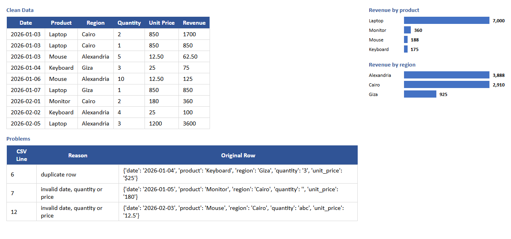

# Sales Report Automation

Turns a messy sales CSV into a clean Excel report.



## What it fixes
- Mixed date formats (`2026-01-03`, `03/01/2026`)
- Prices written as `$25` or `1,200`
- Inconsistent text (` laptop `, `ALEXANDRIA`)
- Duplicate rows
- Rows with missing or invalid values are kept out of the report and listed on a **Problems** sheet with the line number and reason

## Output (`report.xlsx`)
| Sheet | Contents |
|---|---|
| Clean Data | Every valid row with a Revenue column |
| By Product | Revenue per product + bar chart |
| By Region | Revenue per region + bar chart |
| Problems | Rejected rows and why |

## Usage
```bash
pip install openpyxl
python report.py sample_sales.csv report.xlsx
```

## Test
```bash
python test_report.py
```
